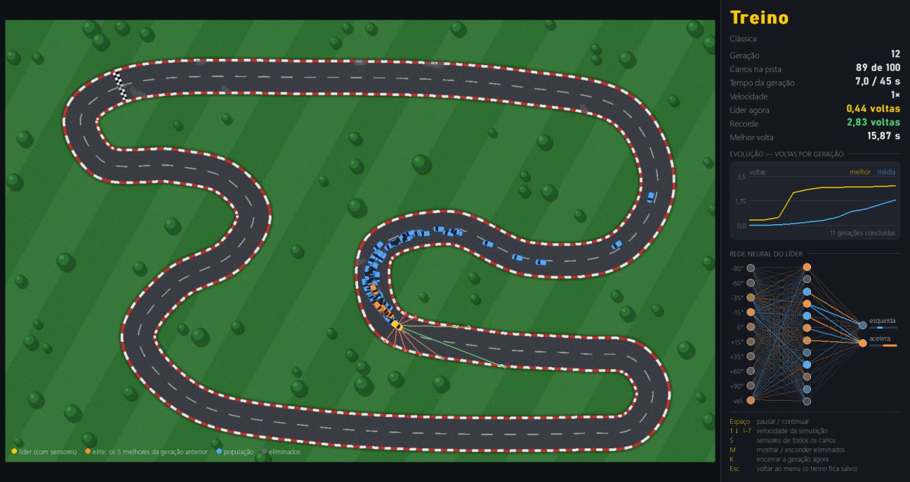
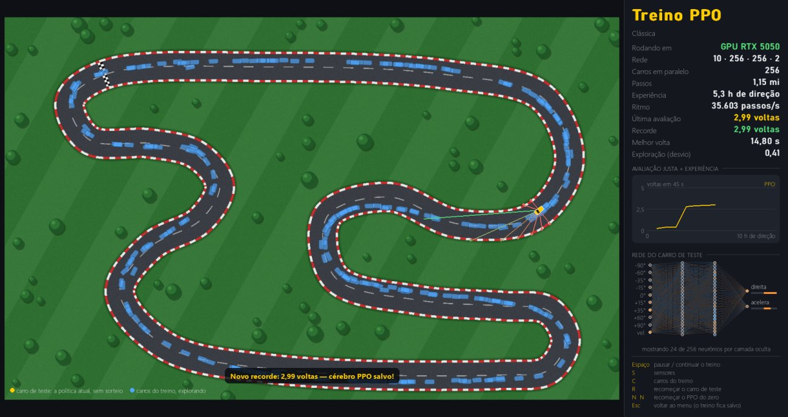

# Corrida IA 🏁

Redes neurais aprendendo a pilotar numa pista de corrida, com duas técnicas lado a lado:

- **Neuroevolução:** uma população de 100 carros, cada um com a sua própria rede neural,
  dirige ao mesmo tempo. Os que vão mais longe passam os "genes" (os pesos da rede)
  para a geração seguinte, com pequenas mutações.
- **Aprendizado por Reforço (PPO):** uma única rede aprende com a experiência de 256
  carros dirigindo em paralelo, recebendo uma recompensa a cada passo — com PyTorch,
  na GPU.

Em poucos minutos elas aprendem a fazer as curvas — e a frear antes delas. Depois dá
para comparar as duas, assistir, correr contra elas e testá-las em pistas que nunca viram.



## Como rodar

**Jeito fácil (Windows):** dê dois cliques em `iniciar.bat`. Na primeira vez ele cria o
ambiente Python e instala as dependências.

**Pelo terminal:**

```bash
python -m venv .venv
.venv\Scripts\python -m pip install -r requirements.txt
.venv\Scripts\python main.py
```

Precisa de Python 3.10 ou mais novo. Dependências: `numpy` e `pygame-ce`.

**Para o PPO** (opcional), instale também o PyTorch — o arquivo já aponta para a versão
com CUDA 12.8, que funciona nas placas NVIDIA, inclusive da série RTX 50 (é um download
de ~3 GB). Sem placa NVIDIA, ele roda na CPU.

```bash
.venv\Scripts\python -m pip install -r requirements-rl.txt
```

## O que dá para fazer

| No menu | O que acontece |
|---|---|
| **Neuroevolução do zero** | Solta 100 carros com redes aleatórias e assiste à evolução. O melhor cérebro é salvo sozinho sempre que bate o recorde. |
| **Continuar neuroevolução** | Retoma a população de onde parou (o treino é salvo a cada geração). |
| **Treinar com PPO** | Aprendizado por Reforço ao vivo: os carros do treino explorando e um carro de teste mostrando o que a rede já sabe. Continua de onde parou. |
| **Assistir a IA** | Um cérebro dirigindo sozinho (B troca de cérebro, ← → troca de pista — inclusive para pistas que ele nunca viu). |
| **Correr contra a IA** | Você (setas ou WASD) contra 3 rivais, em 3 voltas — misturando as duas técnicas quando houver as duas. |
| **Comparar as técnicas** | Cada cérebro salvo em cada pista, com a mesma avaliação, e as curvas de aprendizado medidas. |
| **Editor de pistas** | Clique para criar pontos, arraste para ajustar; a pista se desenha sozinha. Teste dirigindo (T) ou veja a IA nela (A). |

Dica para o treino: aperte **7** (velocidade máxima) e acompanhe o gráfico. Na pista
*Clássica* a primeira volta completa costuma sair perto da geração 10, e o tempo de
volta segue caindo por dezenas de gerações.

As pistas vêm em ordem de dificuldade: Oval → Feijão → Serpentina → Clássica → Desafio.

## Como funciona

**O carro** tem física simples: acelera, freia e vira — mas os pneus têm aderência
limitada, então em alta velocidade ele não consegue fazer curvas fechadas. Para ir
rápido, a rede precisa aprender a *frear antes das curvas*.

**Os sensores** são 9 raios (de −90° a +90°) que medem a distância até a borda da pista.
Junto com a velocidade, formam as 10 entradas da rede.

**A rede neural** é um perceptron com uma camada oculta de 12 neurônios (tanh) e 2 saídas:
direção (−1 esquerda … +1 direita) e acelerador (−1 freia … +1 acelera). Ela é
escrita só com NumPy, e a população inteira é avaliada de uma vez.

**O fitness** (a nota de cada carro) é a distância que ele percorreu no sentido da pista
antes de bater, parar de avançar por 3 s ou acabar o tempo da geração (45 s).
Quem é mais rápido anda mais no mesmo tempo, então a velocidade também é premiada.

**O algoritmo genético**, a cada geração:
1. mantém os 5 melhores intactos (elite — os carros laranja na tela);
2. escolhe pais por torneio (sorteia 3, fica com o melhor);
3. cruza os pais neurônio a neurônio;
4. muta ~10% dos pesos de cada filho com ruído gaussiano;
5. adiciona 5% de indivíduos totalmente novos, para manter a diversidade.

Não há backpropagation: a rede melhora só por seleção e mutação, como na evolução natural.

## Aprendizado por Reforço (PPO)



O PPO usa a mesma pista, a mesma física, as mesmas 10 entradas e as mesmas 2 saídas —
só muda a forma de aprender:

| | Neuroevolução | PPO |
|---|---|---|
| **Quantas redes** | 100 (uma por carro) | 1, que todos os carros usam |
| **Sinal de aprendizado** | uma nota por carro, no fim da geração | uma recompensa a cada passo: quanto o carro avançou (bater encerra o episódio) |
| **Como melhora** | seleção, cruzamento e mutação | gradiente (backpropagation), com o PyTorch |
| **Como explora** | mutações aleatórias nos pesos | sorteia cada comando em volta do que a rede sugere |
| **Onde o carro começa** | sempre na linha de chegada | num ponto aleatório da pista (treina todos os trechos desde o início) |
| **Tamanho da rede** | 10 · 12 · 2 (~160 pesos) | 10 · 256 · 256 · 2 (~69 mil pesos) |

Em cada iteração, os 256 carros dirigem 128 passos; a rede do **crítico** estima quanta
recompensa ainda vem pela frente, e a diferença para o que aconteceu (a *vantagem*, via GAE)
diz se cada ação foi melhor ou pior que o esperado. A rede do **ator** então aumenta a
probabilidade das ações boas — mas o *clip* do PPO limita quanto ela pode mudar de uma vez,
o que deixa o treino estável.

O ator termina numa tangente hiperbólica, como a rede da neuroevolução: o cérebro do PPO é
salvo no mesmo formato (`cerebros/<pista>.ppo.npz`) e funciona em todas as telas.

**E a GPU?** Para redes pequenas, a parte cara é a física dos carros (NumPy, na CPU), e a
GPU não ajuda. Ela brilha na rede grande: com 256 × 256 neurônios, a atualização fica ~4,7×
mais rápida que na CPU, e o treino roda a ~40 mil passos/s na RTX 5050 — na CPU, a mesma
rede faria metade disso. Por isso o padrão é 256 × 256 na GPU e 64 × 64 na CPU.

## Neuroevolução × PPO

`python main.py comparar` (ou **K** no menu) avalia todos os cérebros salvos em todas as
pistas e gera [`resultados/comparacao.md`](resultados/comparacao.md).
`python main.py comparar --curvas --pista classica` treina as duas técnicas do zero, com o
mesmo orçamento de experiência, e mede as curvas de aprendizado.

### O que medimos (RTX 5050, outubro de 2026)


**Mesma pista, mesmo orçamento (30 h de direção simulada para cada técnica, do zero):**

| | Clássica: Neuro | Clássica: PPO | Desafio: Neuro | Desafio: PPO | teste01: Neuro | teste01: PPO |
|---|---|---|---|---|---|---|
| 1ª volta completa (experiência) | **1,3 h** | 3,0 h | **1,1 h** | 3,0 h | **2,5 h** | 5,3 h |
| 1ª volta completa (relógio) | **6 s** | 16 s | **4 s** | 19 s | **9 s** | 28 s |
| Voltas em 45 s, no fim | 3,11 | **3,13** | 3,11 | **3,15** | 2,52 | **2,70** |
| Melhor volta | 14,17 s | **14,12 s** | 14,17 s | **13,98 s** | 17,67 s | **16,47 s** |
| Tempo total de relógio | **65 s** | 166 s | **65 s** | 168 s | **73 s** | 148 s |

- A **neuroevolução larga na frente**: com 100 políticas inteiras sendo sorteadas, alguma
  logo acerta a pista. O PPO precisa de 3 a 5 h de experiência até "entender" a primeira volta.
- Depois disso o **PPO aprende mais por hora de experiência** e termina na frente — pouco nas
  pistas fáceis, onde as duas chegam perto do limite da física do carro, e mais na teste01,
  a pista com os grampos mais fechados (1,2 s por volta).
- Em **tempo de relógio, a neuroevolução sai 2 a 2,6× mais barata**: não tem backpropagation e
  a rede dela tem 160 pesos, contra 69 mil.

**A recompensa importa muito no PPO.** Na primeira versão, bater custava uma penalidade, e o
PPO travava em 0,32 volta na teste01: aprendia a *parar* antes do grampo, porque ser eliminado
por ficar parado custava a mesma penalidade, só que 3 s depois — e o PPO desconta o futuro.
Com a recompensa sendo só o avanço na pista (o mesmo que o fitness da neuroevolução mede),
um horizonte maior e mais exploração no começo, ele passou a resolver a pista.

**E por que os carros do PPO largam espalhados?** Cada carro é uma tentativa independente, e
a rede aprende com cada passo de cada um. Largar de pontos aleatórios treina a pista inteira
desde o começo. Testamos largar todos da linha, como na neuroevolução: o PPO travou no primeiro
grampo da teste01 (0,25 volta), porque nunca praticava o resto da pista (`--largada-na-linha`).

**Generalização** (`python main.py comparar` avalia os cérebros que estiverem salvos — os
números abaixo são de uma rodada; treinos diferentes dão cérebros diferentes):

- Treinados na Clássica, os dois andam bem no Oval, no Feijão e na Serpentina, que nunca
  viram. No Desafio, só o PPO passou (3,07 voltas); a neuroevolução bateu.
- **A pista de treino importa tanto quanto a técnica**: o cérebro de neuroevolução treinado
  na teste01, a pista mais difícil, passou em todas as outras (4,47 voltas de média nas
  inéditas), enquanto cérebros treinados em pistas fáceis, como o Feijão, batem nas difíceis.
- Treinar o PPO em várias pistas ao mesmo tempo (`--pistas`) deu um cérebro que dirige em
  cada uma tão bem quanto o especialista daquela pista.

Cada número vem de uma única execução de treino, e os dois métodos usam sorteios. Rodando
de novo, os números mudam um pouco — principalmente quando a neuroevolução acha a primeira
volta.

## Linha de comando

```bash
python main.py                                    # menu
python main.py treinar --pista classica           # neuroevolução, com janela
python main.py treinar --pista desafio --sem-janela --geracoes 200   # bem mais rápido
python main.py treinar --pista desafio --continuar
python main.py ppo --pista classica               # PPO, com janela
python main.py ppo --pista classica --sem-janela --milhoes 6
python main.py ppo --pistas classica,desafio,feijao,serpentina --sem-janela --milhoes 20
python main.py comparar                           # todos os cérebros em todas as pistas
python main.py comparar --curvas --pista classica --horas 30
python main.py assistir --pista serpentina
python main.py correr --pista feijao
python main.py editor --pista oval
```

O nome da pista é o do arquivo em `pistas/`, sem o `.json`.

## Experimente

Tudo que dá para ajustar está em [`corrida/config.py`](corrida/config.py):

- **Física:** `ADERENCIA` menor deixa as curvas mais traiçoeiras; `VELOCIDADE_MAX` maior exige mais freio.
- **Sensores:** menos raios, ou alcance menor, e veja se a IA ainda consegue.
- **Rede:** `CAMADAS_OCULTAS = (8,)` ou `(16, 8)`.
- **Evolução:** `TAXA_MUTACAO`, `FORCA_MUTACAO`, `ELITE`, `TAMANHO_POPULACAO`.
- **PPO:** os parâmetros ficam em `ParametrosPPO`, em [`corrida/rl/ppo.py`](corrida/rl/ppo.py);
  na linha de comando, `--camadas 64,64` e `--carros 128`.

Cada cérebro guarda a própria arquitetura, então mudar as camadas não esconde os cérebros
já treinados. Só mudar os sensores os deixa incompatíveis (aí é treinar de novo).

## Estrutura

```
main.py                 ponto de entrada (menu e linha de comando)
corrida/
  config.py             parâmetros da simulação, da rede e da evolução
  pista.py              spline da pista, máscara de asfalto, sensores e progresso
  carros.py             física, colisão e voltas (toda a frota de uma vez, com NumPy)
  rede_neural.py        a rede neural (MLP) em NumPy
  evolucao.py           o algoritmo genético
  treino.py             o laço de gerações (também roda sem janela)
  rl/ambiente.py        o ambiente do Aprendizado por Reforço (recompensa, episódios)
  rl/ppo.py             o PPO em PyTorch (ator-crítico, GAE, clip)
  piloto.py             qualquer cérebro salvo pronto para dirigir
  avaliacao.py          a avaliação justa, igual para as duas técnicas
  comparacao.py         generalização e curvas de aprendizado
  arquivos.py           salvar/carregar cérebros e o estado do treino
  desenho.py            desenho da pista, carros, sensores, gráficos e rede
  interface.py, app.py  janela, fontes, botões e painel
  telas/                menu, treino, PPO, assistir, corrida, comparação e editor
pistas/                 as pistas (JSON: nome, largura e pontos de controle)
cerebros/               criada no primeiro treino: <pista>.npz, .treino.npz, .ppo.npz e .ppo.pt
resultados/             relatório e curvas da comparação
tests/                  testes (python -m unittest discover tests)
```
