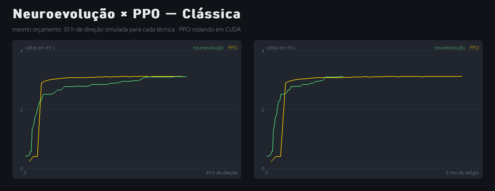
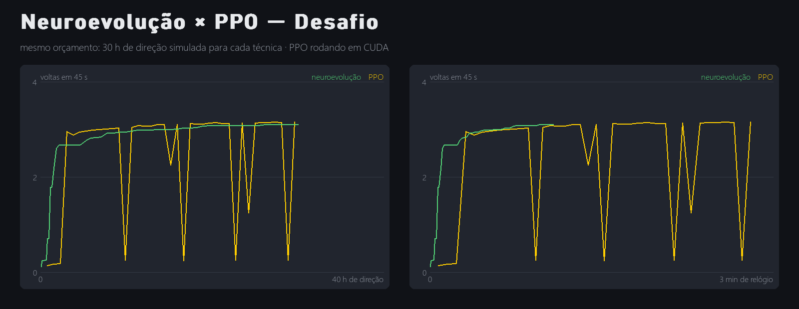
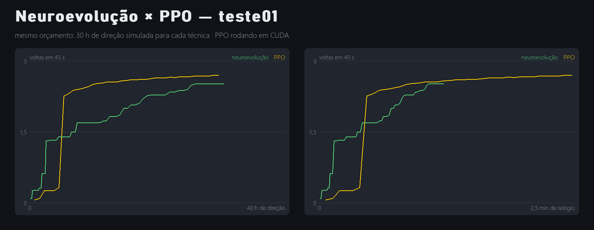

# Neuroevolução × PPO

Gerado em 24/10/2026 20:38 por `python main.py comparar`.

## Generalização: voltas em 45 s em cada pista

Mesma avaliação para todos: larga parado da linha de chegada e dirige até bater ou acabar o tempo. Em **negrito**, a pista (ou pistas) em que o cérebro treinou; `x` = bateu antes do tempo.

| Cérebro | Oval | Feijão | Serpentina | Clássica | Desafio | teste01 | Média nas pistas vistas | Média nas inéditas |
|---|---|---|---|---|---|---|---|---|
| Neuroevolução · Clássica | 5,93 | 5,35 | 4,86 | **3,15** | 0,62 x | 0,26 x | 3,15 | 3,40 |
| PPO · Clássica | 5,75 | 5,14 | 4,64 | **3,06** | 3,07 | 0,25 x | 3,06 | 3,77 |
| Neuroevolução · Desafio | 4,91 | 4,49 | 3,69 | 2,46 | **2,60** | 0,26 x | 2,60 | 3,16 |
| PPO · Desafio | 5,83 | 5,29 | 4,77 | 3,04 | **3,15** | 0,25 x | 3,15 | 3,84 |
| Neuroevolução · teste01 | 5,89 | 5,34 | 4,88 | 3,10 | 3,13 | **2,75** | 2,75 | 4,47 |
| PPO · teste01 | 5,79 | 5,14 | 4,12 | 2,89 | 0,39 x | **0,32 x** | 0,32 | 3,67 |

## Curvas de aprendizado (do zero, mesmo orçamento de experiência)

### Clássica — 30 h de direção para cada técnica

| | Neuroevolução | PPO |
|---|---|---|
| 1ª volta completa — experiência | 1,3 h | 3,0 h |
| 1ª volta completa — relógio | 6 s | 16 s |
| Voltas em 45 s (melhor avaliação) | 3,11 | 3,13 |
| Melhor volta | 14,17 s | 14,12 s |
| Tempo total de relógio | 65 s | 166 s |

### Desafio — 30 h de direção para cada técnica

| | Neuroevolução | PPO |
|---|---|---|
| 1ª volta completa — experiência | 1,1 h | 3,0 h |
| 1ª volta completa — relógio | 4 s | 19 s |
| Voltas em 45 s (melhor avaliação) | 3,11 | 3,15 |
| Melhor volta | 14,17 s | 13,98 s |
| Tempo total de relógio | 65 s | 168 s |

### teste01 — 30 h de direção para cada técnica

| | Neuroevolução | PPO |
|---|---|---|
| 1ª volta completa — experiência | 2,5 h | 5,3 h |
| 1ª volta completa — relógio | 9 s | 28 s |
| Voltas em 45 s (melhor avaliação) | 2,52 | 2,70 |
| Melhor volta | 17,67 s | 16,47 s |
| Tempo total de relógio | 73 s | 148 s |
